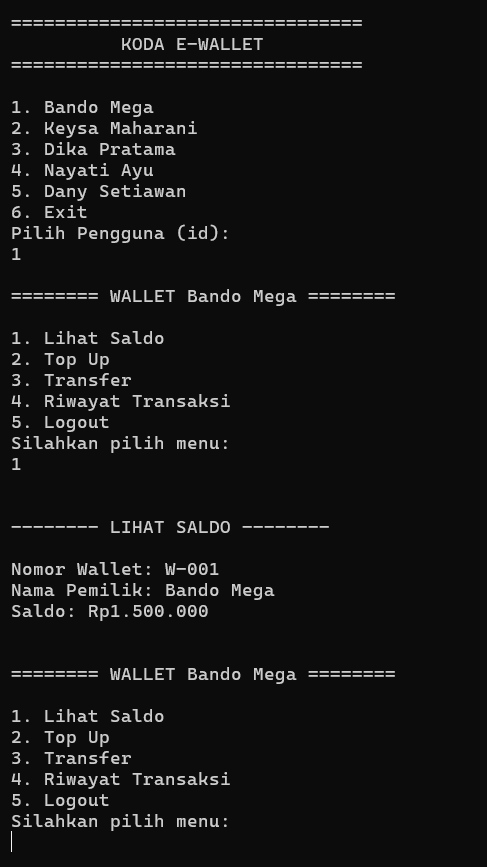
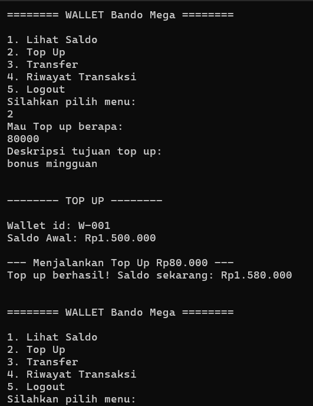
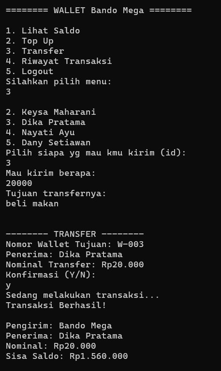
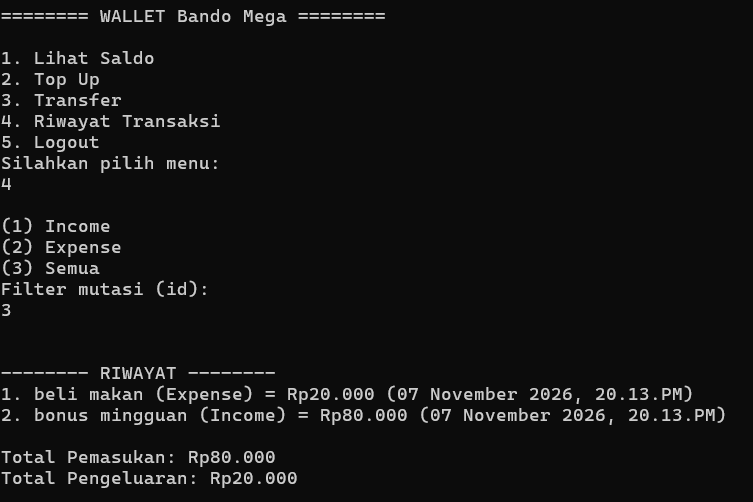

# E-Wallet

Aplikasi Ewallet menggunakan bahasa **Dotnet** (console) versi 10.0 dan **Java** (murni) versi 25.0.4.1.

## Fitur

- Memilih pengguna dari daftar (5 pengguna seed).
- Lihat saldo.
- Top up saldo dengan keterangan tujuan.
- Transfer ke pengguna lain dengan konfirmasi (Y/N).
- Riwayat mutasi dengan filter Income, Expense, atau All, lengkap dengan total.
- Format nominal Rupiah dan tanggal berbahasa Indonesia.

## Alur Aplikasi

1. Pertama, aplikasi dijalankan.
2. Lalu pengguna memilih akun yang mau dipakai dari daftar pengguna yang tampil.
3. Setelah itu muncul menu utama: Lihat Saldo, Top Up, Transfer, dan Riwayat Transaksi.
4. Pengguna tinggal memilih salah satu menu yang dibutuhkan.
5. Dari menu itu, pengguna bisa:
   - Top Up, untuk menambah saldo wallet.
   - Transfer, untuk mengirim saldo ke pengguna lain.
   - Riwayat, untuk melihat transaksi yang pernah dilakukan.
6. Sebelum transaksi diproses, sistem mengecek dulu apakah transaksinya valid.
7. Kalau berhasil, saldo wallet langsung diperbarui dan transaksinya dicatat ke riwayat.
8. Selesai itu, pengguna bisa logout untuk kembali ke daftar pengguna, memilih user lain, atau memilih Exit kalau mau keluar dari aplikasi.

## Struktur Class

### Java

```bash
com.ewallet
├── App.java -> entry point, menu console
├── data
│ └── DbContext.java -> penyimpanan in-memory (users, wallets, transactions, mutations)
├── model
│ ├── User.java
│ ├── Wallet.java
│ ├── Transaction.java
│ ├── Mutation.java
│ └── TransactionTypeEnum.java -> Income | Expense
├── service
│ ├── WalletService.java -> interface
│ ├── WalletServiceImpl.java
│ ├── TransactionService.java -> interface
│ ├── TransactionServiceImpl.java
│ └── UserServiceImpl.java
└── utils
  └── Helper.java -> format Rupiah dan tanggal

```

### .NET

Namespace dasar: `Ewallet.Console`. Struktur folder mengikuti namespace.

```
Ewallet.Console
├── Program.cs                    -> entry point (top-level statements), menu console
├── Data
│   └── InMemoryDbContext.cs      -> penyimpanan in-memory
├── Interfaces
│   ├── IWalletService.cs
│   └── ITransactionService.cs
├── Models
│   ├── User.cs
│   ├── Wallet.cs
│   ├── Transaction.cs            -> sealed class
│   └── Mutation.cs               -> berisi juga enum TransactionTypeEnum
└── Services
    ├── WalletService.cs
    ├── TransactionService.cs
    └── UserService.cs
```

### Peran tiap class

| Class                                           | Peran                                                                                                                           |
| ----------------------------------------------- | ------------------------------------------------------------------------------------------------------------------------------- |
| `App`                                           | Entry point. Menampilkan menu, membaca input, memanggil service.                                                                |
| `DbContext`                                     | Menyimpan list `User`, `Wallet`, `Transaction`, `Mutation` beserta data seed. Satu instance dibagi ke semua service.            |
| `User`                                          | Data pengguna: id, username, password hash, email, foto, nama lengkap, telepon, waktu dibuat/diubah.                            |
| `Wallet`                                        | Data dompet: id, nomor akun, PIN hash, id pemilik, saldo. Memiliki operasi `Debit` (tambah saldo) dan `Credit` (kurangi saldo). |
| `Transaction`                                   | Header transaksi: id (UUID) dan nomor referensi `REF-xxxx`.                                                                     |
| `Mutation`                                      | Detail pergerakan saldo: nominal, deskripsi, tipe (Income/Expense), id wallet, id transaksi.                                    |
| `TransactionTypeEnum`                           | Enum jenis mutasi: `Income` dan `Expense`.                                                                                      |
| `WalletService` / `WalletServiceImpl`           | Kontrak dan implementasi operasi wallet: lihat saldo, cari wallet berdasarkan user, tambah/kurangi saldo.                       |
| `TransactionService` / `TransactionServiceImpl` | Kontrak dan implementasi transfer, top up, dan riwayat mutasi (termasuk perhitungan total).                                     |
| `UserServiceImpl`                               | Membuat user, mencari user berdasarkan id, mengambil semua user.                                                                |
| `Helper`                                        | Utilitas format nominal Rupiah dan format tanggal bahasa Indonesia.                                                             |

## Penerapan OOP

### 1. Encapsulation

Penerapan OOP terletak pada setiap class, diantaranya pada directory models. Setiap entity dibungkus dalam class dan diakses lewat getter/setter. misal pada `User` yg fieldnya `private`. Perubahan saldo di `Wallet` dilakukan melalui method `Debit` dan `Credit`.

### 2. Abstraction

Konsep abstraction yaitu untuk menyembunyikan detail implementasi internal disuatu objek dan hanya menampilkan fungsionalitas yg penting kepada pengguna. Penerapannya pada Inheriance di `WalletService` dan `TransactionService`. Pemanggil cukup tahu yg bisa dilakukan (`Transfer`, `TopUp`, `GetMutaionHistory`) tanpa perlu tahu cara kerja di dalamnya.

### 3. Polymorphism (lewat interface)

`WalletServiceImpl` dan `TransactionServiceImpl` mengimplementasikan interface masing-masing. Implementasi dapat diganti (misalnya versi yang memakai database) tanpa mengubah kontraknya.

## Cara Menjalankan kedua aplikasi,

### Java

**Prasyarat**

- JDK **25**
- Maven

**Langkah**

```bash
# masuk ke folder proyek Java
cd koda-b1-weekly4/java

# compile
mvn clean compile exec:java -Dexec.mainClass="com.ewallet.App"

```

### .NET

**Prasyarat**

- .NET SDK **10.0** (kode memakai top-level statements, file-scoped namespace, dan implicit usings).

**Langkah**

```bash
cd koda-b1-weekly4/dotnet/src/Ewallet.Console

# jalankan
dotnet run
```

## Perbandingan Java/.NET

| Aspek                        | Java                                          | .NET (C#)                                                                                                  |
| ---------------------------- | --------------------------------------------- | ---------------------------------------------------------------------------------------------------------- |
| Entry point                  | `public static void main` di class `App`      | Top-level statements di `Program.cs`                                                                       |
| Interface                    | `interface` + `implements`, tanpa prefix      | `interface` + `:`, dengan prefix `I`                                                                       |
| Properti                     | Field + getter/setter manual                  | Auto-property `{ get; private set; }`                                                                      |
| Collection                   | `List<T>` / `ArrayList<T>`                    | `List<T>`                                                                                                  |
| Query data                   | Stream API (`stream().filter().findFirst()`)  | LINQ (`Where`, `FirstOrDefault`, `Sum`, `OrderByDescending`)                                               |
| Tipe nominal uang            | `long`                                        | `decimal`                                                                                                  |
| Null safety                  | `orElse(null)` dan cek manual                 | Nullable reference types (`User?`, `??`, `?.`)                                                             |
| Enum                         | `enum` di file sendiri                        | `enum` di file `Mutation.cs`                                                                               |
| ID unik                      | `UUID.randomUUID()`                           | `Guid.NewGuid().ToString()`                                                                                |
| Nomor referensi              | `REF-` + 4 digit acak                         | `REF-` + `DateTime.UtcNow.Ticks`                                                                           |
| Input console                | `Scanner` (`nextLine`, `nextInt`, `nextLong`) | `Console.ReadLine()`                                                                                       |
| Format Rupiah                | `NumberFormat` + `Locale` (lewat `Helper`)    | `ToString("C0", CultureInfo)`                                                                              |
| Format tanggal               | `DateTimeFormatter` + `Locale`                | `ToString("dd MMMM yyyy, ...", CultureInfo)`                                                               |
| Pembagian tugas input/logika | Service memegang `Scanner` dan mencetak       | `TopUp`/`Transfer` menerima parameter; input dibaca di `Program.cs` (konfirmasi transfer masih di service) |
| Penanganan error             | Pesan ke console lalu `return`                | Service melempar `ArgumentException` (validasi di `Wallet` dan service)                                    |
| Validasi di model            | Belum ada                                     | Konstruktor dan `Credit`/`Debit` di `Wallet` memvalidasi nominal                                           |
| Konvensi nama method         | camelCase (kode saat ini memakai PascalCase)  | PascalCase                                                                                                 |
| Build dan run                | Maven                                         | `dotnet run`                                                                                               |

## Screenshot Pengujian

### Pengujian Memilih User Login & Lihat Saldo.



### Pengujian Top Up



### Pengujian Transfer



### Pengujian Melihat Mutasi


